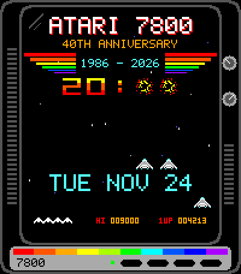
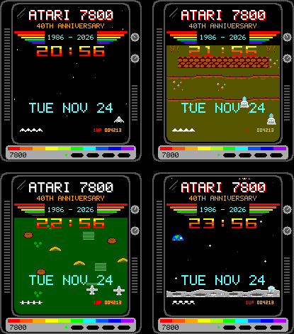
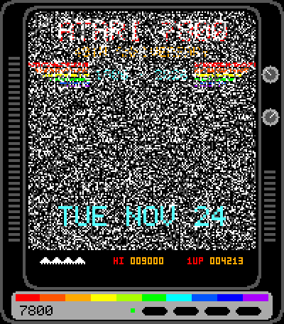

# Pebble Time 2 7800

A watch face for the Pebble Time 2 celebrating the Atari 7800's 40th
anniversary (1986–2026). The screen of a little 7800-styled TV runs a real
7800 cartridge on a 6502 and MARIA emulated on the watch itself. The cartridge
draws the time and acts out every minute change, with a different show each
hour. The emulator is silent: the watch has no speaker, so there is no sound.



## What it does

From :57 to :02 of every minute, one of four shows plays the minute change.
The show is picked by the hour and the channel (see below).



| (hour + channel) mod 4 | show | backdrop |
|---|---|---|
| 0 | **Formation**: two attackers fly in and fire three volleys, the old minute explodes and the new one fades in | deep space, with a three-layer star field falling behind ([closer look](docs/starfield.gif)) |
| 1 | **Drill rig**: a rig bores up through the rock (chips falling, a dark shaft opening behind it), the old minute shakes and crumbles, the rig pushes the new one up into place, and once it sinks back out the rock grows back over the shaft | under ground: earth, roots, strata, stones and a fossil |
| 2 | **Bomber run**: the ground scrolls, a bomber climbs in and its bomb takes out the old minute; the new one fades in as it flies off | farmland: fields, trees and houses scrolling by |
| 3 | **Lander**: a lander comes down, lifts the old minute away and sets the new one down in a puff of dust | the Moon: an Earthrise -- a big half Earth coming up over the lunar hills, stars above, cratered ground in front |

**Changing the channel.** A wrist flick moves to the next show: a moment of TV
static, then the next show comes on. The shows still rotate hourly from there.
The face remembers the channel when it restarts. A new show always comes in
through static: after a flick, at the top of the hour, and when the face
starts.



**Reading the screen**

- **Time:** the large digits, in 24-hour form. The date is on the glass below
  the picture.
- **Lives (bottom left):** battery, one life per 20%. They turn green while
  charging and red on the last life.
- **1UP score:** today's steps.
- **Cruiser:** the vehicle along the bottom crosses the screen once an hour, so
  its position tells you how far into the hour you are. The cruiser and the
  lives match the current show: ship, rig, plane or lander.
- **Power light:** green while the phone is connected, red when it isn't. A
  lost connection also vibrates.
- **Channel knob:** the upper knob on the right turns with the show.

**Battery.** The screen only changes during short animation bursts: from :57 to
:03 every minute, and for six seconds after a flick. Battery and steps are read
once, as a burst starts, so the lives and the score move at most once a burst.

## Installing

The face is a Pebble project in `watchface/`, targeting the Pebble Time 2
(emery).

**CloudPebble:** import the repository from GitHub and build. CloudPebble pulls
the code from GitHub but not the cartridge. Whenever
`watchface/resources/data/clockstub.a78` changes, upload it again by hand as the
`STUB_ROM` raw resource.

**Pebble SDK:**

```
cd watchface
pebble build
pebble install --emulator emery      # or --phone <ip>
```

In `watchface/src/c/main.c`:

- `EMU_FRAMES_PER_DRAW` sets how many 7800 frames run per watch frame (4 is real
  time). The face logs how many milliseconds a draw takes, every 30 draws.
- `USE_EMULATOR` switches between the cartridge (1) and the earlier hand-drawn
  hourly scenes (0).

## How it works

- **The 7800 on the watch** (`watchface/src/c/emu`): an NMOS 6502 (undocumented
  opcodes included), MARIA with the a7800 MAME fork's DMA timing, and the RIOT
  timer. It starts the cartridge the way the fork's no-BIOS mode does. When the
  cartridge sits in a loop waiting for vertical blank, the emulator skips ahead
  instead of running the loop.
- **The cartridge** (`tools/mkstub.py` builds `clockstub.a78`, 16K): it reads
  the time, battery, steps and channel from the
  [clock registers](docs/clock-registers.md) at `$0600-$060F` every frame, and
  counts frames within a second, so it never drifts from the watch's clock.
  - **Display lists:** built a frame ahead, in two sets that take turns.
  - **Moving actors:** placed to the line across zone boundaries with holey
    DMA, as 7800 games do.
  - **Backdrops:** drawn first in each zone. The still ones are built once and
    kept at the head of each list.
  - **Lives and score bar:** drawn in character mode.
- **The face** (`watchface/src/c/main.c`) draws the TV and then runs the
  emulator straight into the screen. It draws the anniversary banner first and
  the date last.
  - In the banner's rows, the cartridge's background colour is see-through, so
    its actors pass in front of the banner.
  - Palette 7 is the backdrop: it passes behind the banner, showing only where
    the banner leaves the screen black.

## Repository

| | |
|---|---|
| `watchface/` | The Pebble project: `src/c/main.c` (the face), `src/c/emu/` (the 7800), `resources/data/clockstub.a78` (the cartridge). |
| `tools/mkstub.py` | Builds the cartridge: code, graphics, backdrops and the static are all generated here. |
| `tools/gen_m6502_tables.py` | Generates the core's opcode tables (`m6502_tables.h`) from the toolkit's `m6502.py`, so both projects share one opcode table. |
| `docs/clock-registers.md` | The read-only block at `$0600-$060F` through which the watch passes the time, battery, steps and channel to a ROM. No mapper or add-on uses that block, so it works with any cartridge size. |
| `tests/a78run.c` | Runs a cartridge on the watch core on this computer. It writes frames as PPM and RAM dumps, and reports per-frame CPU/DMA/WSYNC time. Options set the clock standing (`-c HHMM`) or running (`-t HHMMSS`), the wrist-flick flag (`-l`), battery (`-b`), steps (`-S`), charging (`-g`), the channel (`-C`), and flicks that change it (`-k`). |
| `tests/vbprobe.c` | Reports the line on which a cartridge's main loop finishes each frame. |
| `tests/harte_pack.py`, `tests/harte_run.c` | Tom Harte's SingleStepTests for the 6502: 10,000 cases per opcode, checking registers, memory and cycle counts. |
| `tests/klaus_run.c` | Klaus Dormann's 6502 functional test. |
| `tests/riot_check.py` | Checks the RIOT test cartridge against MAME's golden RAM dump, using the toolkit selftest's own rule. |
| `tests/dma_fit.py` | Runs the toolkit's DMA cost cartridges on the core and fits the same model that `dmameasure.py --fit` fits to MAME. |

The build scripts and tests use the
[a7800-toolkit](https://github.com/Miasmark/a7800-toolkit), checked out beside
this repository: its assembler, `newgame.header()`, the opcode table, the RIOT
test cartridge with MAME's dump, and the DMA cost cartridges.

## Building and testing

```
# the opcode tables (only when the toolkit's m6502.py changes)
python tools/gen_m6502_tables.py --toolkit ../a7800-toolkit \
    -o watchface/src/c/emu/m6502_tables.h

# the cartridge, then into the watch face's resources
python tools/mkstub.py --toolkit ../a7800-toolkit -o build/clockstub.a78
cp build/clockstub.a78 watchface/resources/data/

# the host runner
W=watchface/src/c/emu
cc -O2 -I$W tests/a78run.c $W/a7800.c $W/m6502.c $W/palette7800.c -o build/a78run
build/a78run build/clockstub.a78 -f 480 -t 202656 -s 0,479 -e 4   # :56 to :04, every 4th frame

# 6502 tests (fetch the vectors first: SingleStepTests/65x02 6502/v1, and
# Klaus2m5/6502_65C02_functional_tests bin_files)
python tests/harte_pack.py path/to/65x02/6502/v1 -o build/harte
cc -O2 -I$W tests/harte_run.c $W/m6502.c -o build/harte_run && build/harte_run build/harte
cc -O2 -I$W tests/klaus_run.c $W/m6502.c -o build/klaus_run
build/klaus_run path/to/6502_functional_test.bin

# 7800 checks
build/a78run ../a7800-toolkit/tests/carts/riot.a78 -f 40 -r build/riot-ram.bin -q
python tests/riot_check.py build/riot-ram.bin ../a7800-toolkit/tests/golden/riot-mame.bin
python tests/dma_fit.py --toolkit ../a7800-toolkit --run build/a78run
```

## Results

| check | result |
|---|---|
| Harte SingleStepTests | All 2,440,000 cases pass for the 244 opcodes that are not JAM. The 12 JAM opcodes halt the CPU by design; the tests record the bus carrying on. |
| Klaus Dormann functional test | Passes (traps at `$3469`). |
| RIOT timer and WSYNC vs MAME (`riot.a78`) | All eight blocks the toolkit checks are exact; the full 4K of RAM is byte-identical to the toolkit simulator's. |
| DMA cost model vs the fork | Ceiling 1,960 iterations (MAME: 1,960); per line 5.657 cycles (fork 5.62), per zone 1.911 (1.89), per object 1.977 (1.99), per byte 0.750 (0.755). |
| Skipping the vertical-blank wait loop | Same frames as running it instruction by instruction, for every show, including channel changes. |
| Cost per watch draw (4 frames, 1 shown) | 2.8–3.2 million x86 instructions on this computer, depending on the show (callgrind, `-Os`). The face's own log gives the milliseconds on the watch. |

The DLI comes out at 13.1 cycles, against the toolkit's `docs/hardware.md`
measurement of 17.4. The fork's current `maria.cpp` no longer charges DMA time
for a DLI, which leaves the 6502's NMI entry and `RTI`: 13 cycles. The 17.4
looks like a measurement of the earlier fork.

## Not done yet

- **The MAME side of the clock registers:** a cartridge device in the fork that
  fills `$0600-$060F` from the host clock, so the cartridge runs the same in
  MAME.
- **The 12-hour clock flag:** CLK_FLAGS bit 7 is passed in, but the cartridge
  always shows 24-hour time.

## License

The code in this repository is released under the [MIT License](LICENSE).

Atari and 7800 are trademarks of their respective owners. This is an
unofficial fan project, not affiliated with or endorsed by Atari. The shows are
original designs, inspired by the 7800's era rather than copied from any game.
